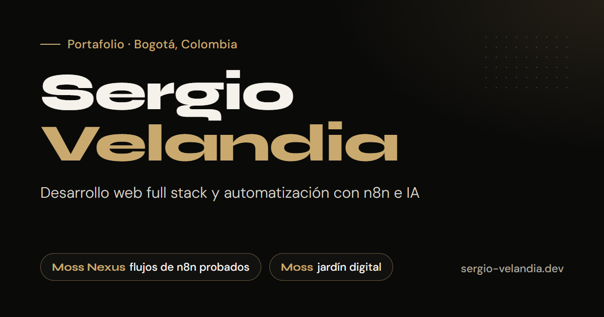

<div align="center">

# ✦ Sergio Velandia — Portafolio Personal

**Desarrollador Web Full Stack · Automatización con n8n & IA — Colombia 🇨🇴**

[](https://react.dev/)
[](https://vitejs.dev/)
[](https://sergio-velandia.dev/mi-portafolio/?lang=en)
[](https://github.com/Sergio-Velandia/mi-portafolio/actions)
[](./LICENSE)

[🌐 Ver en vivo](https://sergio-velandia.dev/mi-portafolio/) · [🇬🇧 English version](https://sergio-velandia.dev/mi-portafolio/?lang=en) · [📬 Contacto](mailto:contacto@sergio-velandia.dev)

Proyectos hermanos: [Moss Nexus](https://sergio-velandia.dev/Moss-Nexus/) · [Moss](https://sergio-velandia.dev/Moss/)



</div>

---

## ✨ Sobre el proyecto

Portafolio personal construido desde cero con **React + Vite**, pensado como una sola página fluida que cuenta una historia: quién soy, qué sé hacer y la prueba de que ya lo hice. Sin plantillas genéricas: cada sección, animación y color se decidió a propósito.

Incluye, entre otras cosas:
- **Bilingüe (español / inglés).** Español por defecto, botón **ES / EN** en el menú, idioma recordado en el navegador y enlace directo en inglés con `?lang=en`.
- **Proyectos al día.** Moss Nexus (v1.0.0 estable, 13 plantillas de n8n y 9 probadas en una instancia real) y Moss (v1.14.0 estable, con 5 rutas de aprendizaje), cada uno con su estado, versión y capturas del sitio en vivo.
- **Flujo de n8n animado.** Recreación del flujo real que "se ejecuta" al llegar a la sección; la captura real queda debajo como prueba.
- **Formulario de contacto sin backend** vía EmailJS, con validación junto a cada campo, mensajes de estado accesibles, campo trampa para bots y un tope de 3 envíos por hora.
- **Privacidad y términos** como páginas HTML reales (bilingües), enlazadas desde el pie.
- **Sin recursos de terceros al cargar:** las fuentes se sirven desde el propio sitio.
- **Accesibilidad AA** verificada: contraste de todos los textos, foco visible y navegación con teclado.

---

## 📌 Estado

| Versión | Estado | Última revisión |
|---|---|---|
| **1.1.0** | En mantenimiento | 23 de octubre de 2026 |

Los cambios de cada versión están en el [CHANGELOG](./CHANGELOG.md) y los pendientes, en el [ROADMAP](./ROADMAP.md).

---

## 🧭 Recorrido de la página

El orden de las secciones en `App.jsx` está pensado como un argumento, no como una lista al azar:

1. **Sobre mí**: quién soy y qué busco.
2. **Certificaciones**: credenciales (IBM, Google, Postman, SENA) para generar confianza rápido.
3. **Habilidades**: el stack técnico completo, en un vistazo.
4. **Experiencia profesional (Roblox)**: trabajo real pagado, un videojuego multijugador de 12 niveles.
5. **Moss Nexus**: el proyecto más fuerte hoy, una librería de flujos de n8n probados.
6. **Moss**: su proyecto hermano, mi "segundo cerebro" técnico con rutas de aprendizaje.
7. **Flujo con n8n**: automatización de datos, con el flujo animado y la captura real.
8. **Otros proyectos**: YuGiOhApi, DigimonAPI + Firebase y este mismo portafolio.
9. **Stats** y **Stack actual**: números y lo que estoy aprendiendo ahora mismo.
10. **Contacto**: formulario directo, sin backend propio.

Una prueba (`src/test/orden.test.js`) mantiene este orden de los proyectos destacados.

---

## 🚀 Proyectos destacados

### 🎮 Videojuego Multijugador en Roblox
Desarrollo completo de una experiencia de **12 niveles** jugables en Roblox Studio (Lua/Luau), con entregas incrementales para un cliente real: pathfinding de NPCs, sistema de fases con temporizadores en servidor, un ritual multijugador cooperativo de 7 pasos con `RemoteEvent`, animaciones, físicas y control anti-exploits.

### 🔗 Moss Nexus: librería de flujos para n8n · v1.0.0 estable
**13 plantillas** de n8n ya armadas, explicadas paso a paso y listas para copiar. **9 tienen el sello «Probado»** en una instancia real (n8n 2.43.5), con datos ficticios y casos trampa; las otras 4 se marcan «Sin probar» a la vista. Búsqueda, filtros (incluido «Solo probadas»), un mapa del flujo que se dibuja solo y copia en un clic, **sin backend**.
[Ver en vivo](https://sergio-velandia.dev/Moss-Nexus/) · [Ver repo](https://github.com/Sergio-Velandia/Moss-Nexus)

### 🌱 Moss: jardín digital · v1.14.0 estable
Mi "segundo cerebro" técnico. Lo que lo separa de un blog son sus **5 rutas de aprendizaje**, que recorren un tema de principio a fin, junto a sus secciones Laboratorio, Manual, Bitácora, Proyectos y Herbario, **sin base de datos ni backend**.
[Ver en vivo](https://sergio-velandia.dev/Moss/) · [Ver repo](https://github.com/Sergio-Velandia/Moss)

### ⚙️ Automatización de procesamiento de datos (n8n)
Flujo que reemplaza la carga manual de datos: recibe archivos CSV desde un webhook, valida y filtra la información, la convierte a XLSX y la sube a Google Drive.
[Ver repo](https://github.com/Sergio-Velandia/Test-N8N)

### Otros
- **YuGiOhApi**: app que consume una API externa para explorar las cartas Yu-Gi-Oh!. [Ver repo](https://github.com/Sergio-Velandia/YuGiOhApi)
- **DigimonAPI + Firebase**: app multiplataforma (Capacitor) con autenticación. [Ver repo](https://github.com/Sergio-Velandia/DigimonAPI-Firebase)

---

## 🗂 Estructura del proyecto

```
mi-portafolio/
├── .github/workflows/
│   └── deploy.yml                # Lint, pruebas, build y publicación en cada push a main
├── privacidad/index.html         # Política de privacidad (HTML estático, ES + EN)
├── terminos/index.html           # Términos de uso (HTML estático, ES + EN)
├── public/
│   ├── og-image.png              # Imagen para redes sociales (Open Graph, 1200×630)
│   ├── sitemap.xml               # Mapa del sitio: inicio, privacidad y términos
│   ├── site.webmanifest, favicons
│   └── *.pdf                     # Certificaciones descargables (IBM, Google, Postman, SENA...)
├── scripts/
│   └── og-card.html              # Fuente de og-image.png (abrir a 1200×630 y capturar)
├── src/
│   ├── assets/                   # Capturas en WebP: flujo de n8n, Moss y Moss Nexus
│   ├── components/               # Una sección por archivo (Header, Certificaciones, RobloxProyecto,
│   │                             #   ProjectShowcase, Proyectos, Stats, Contacto, Footer…)
│   ├── data/
│   │   ├── nexus.js              # Textos, cifras y capturas de Moss Nexus (ES + EN)
│   │   └── moss.js               # Textos, cifras y capturas de Moss (ES + EN)
│   ├── config/sites.js           # URLs del portafolio, Moss y Moss Nexus (un solo lugar)
│   ├── lib/envios.js             # Tope de envíos del formulario (lógica pura, con pruebas)
│   ├── test/                     # Pruebas con Vitest
│   ├── i18n.js / LanguageProvider.jsx  # Idioma: contexto, URL, <html lang>, título y descripción
│   ├── fonts.js                  # Fuentes autoalojadas (@fontsource), solo los pesos usados
│   ├── App.jsx / App.css         # Composición de secciones y sistema de diseño
│   ├── legal.css                 # Estilos de las páginas legales
│   └── animation.js, extras.js, heroNetwork.js, skillsFloat.js
├── LICENSE                       # MIT (código)
├── LICENSE-CONTENT               # Derechos reservados (contenido)
└── vite.config.js                # base '/mi-portafolio/' y las tres páginas del build
```

---

## 🛠 Desarrollo

Requisitos: Node.js 22 y npm.

```bash
git clone https://github.com/Sergio-Velandia/mi-portafolio.git
cd mi-portafolio
npm install
npm run dev        # http://localhost:5173/mi-portafolio/
```

| Comando | Qué hace |
|---|---|
| `npm test` | Pruebas con Vitest: idiomas, cifras de los proyectos, orden de secciones, datos personales, metadatos, páginas legales, contraste y tope de envíos |
| `npm run lint` | Revisión del código con oxlint |
| `npm run build` | Build de producción en `dist/` (inicio, privacidad y términos) |
| `npm run preview` | Sirve el build localmente |

El CI corre `lint`, `test` y `build` antes de publicar.

---

## ⚡ Stack

| Capa | Tecnología |
|---|---|
| UI | React 19, CSS con variables (sin framework de estilos), React Icons |
| Build | Vite 7, varias páginas (inicio + legales) |
| Fuentes | Syne y DM Sans autoalojadas con @fontsource |
| Idiomas | Context API, sin librerías externas |
| Formulario | EmailJS |
| Calidad | Vitest, oxlint |
| Hosting | GitHub Pages con GitHub Actions, dominio propio |

---

## 🎨 Sistema de diseño

Los valores viven como variables en `src/App.css`: fondo grafito cálido (`--bg-base: #0a0a09`), un único acento oro mate (`--accent: #c9a96e`) y textos que cumplen **AA**: `--text-muted` alcanza 4,5:1 sobre todos los fondos y `--text-outline` se reserva al texto grande en contorno (3:1). Una prueba calcula estos contrastes.

**Tipografía:** `Syne` para títulos y `DM Sans` para el cuerpo. **Movimiento:** se animan solo `transform` y `opacity`, nada se repite al volver a hacer scroll y todo respeta `prefers-reduced-motion`.

---

## 🌍 Idiomas

- El sitio carga en **español**. El botón **ES / EN** cambia el contenido, el `lang` del documento, el título y la descripción; [`?lang=en`](https://sergio-velandia.dev/mi-portafolio/?lang=en) abre directamente la versión en inglés.
- Cada componente guarda sus textos en `{ es, en }` y elige el suyo con `useLang()`. Las pruebas comparan los campos y las cifras de los proyectos entre los dos idiomas.
- Las páginas legales tienen las dos versiones en la misma página (inglés en `#en`).

> ⚠️ Las `key` de las listas deben ser identificadores fijos, nunca el texto traducido: si la `key` cambia con el idioma, React recrea el elemento y se pierden las clases de animación.

---

## ☁️ Despliegue

Cada push a `main` ejecuta `.github/workflows/deploy.yml` (lint, pruebas, build) y publica `dist/` en la rama `gh-pages`. El sitio se sirve en [sergio-velandia.dev/mi-portafolio](https://sergio-velandia.dev/mi-portafolio/): el dominio se configura en el repositorio raíz `Sergio-Velandia.github.io`, así que este repositorio **no lleva `CNAME`**.

Privacidad y términos son **HTML reales generados en el build**, no rutas de la SPA, para que respondan 200 y los buscadores los indexen. Cualquier página nueva debe seguir la misma regla.

---

## 📬 Formulario de contacto

Usa [EmailJS](https://www.emailjs.com/) (plan gratuito, con cuota mensual). Las constantes públicas están en `src/components/Contacto.jsx`; quedan visibles en el navegador por diseño, así que el servicio debe estar **restringido al dominio `sergio-velandia.dev`** desde el panel de EmailJS. La plantilla usa `{{from_name}}`, `{{reply_to}}` y `{{message}}`.

Lo que el formulario hace con los datos está descrito en la [política de privacidad](https://sergio-velandia.dev/mi-portafolio/privacidad/).

---

## 📄 Licencia

- **Código:** licencia [MIT](./LICENSE). Puedes estudiarlo, copiarlo y reutilizarlo citando el aviso de copyright.
- **Contenido:** todos los derechos reservados ([LICENSE-CONTENT](./LICENSE-CONTENT)). Los textos, certificados, capturas, la imagen de vista previa y la marca personal no se pueden copiar ni publicar como propios.
- Roblox, n8n y las demás marcas mencionadas pertenecen a sus titulares; este proyecto no está afiliado a ellas.

---

<div align="center">
  Hecho con mucho café ☕ por <strong>Sergio Velandia</strong> — Colombia 🇨🇴
</div>
