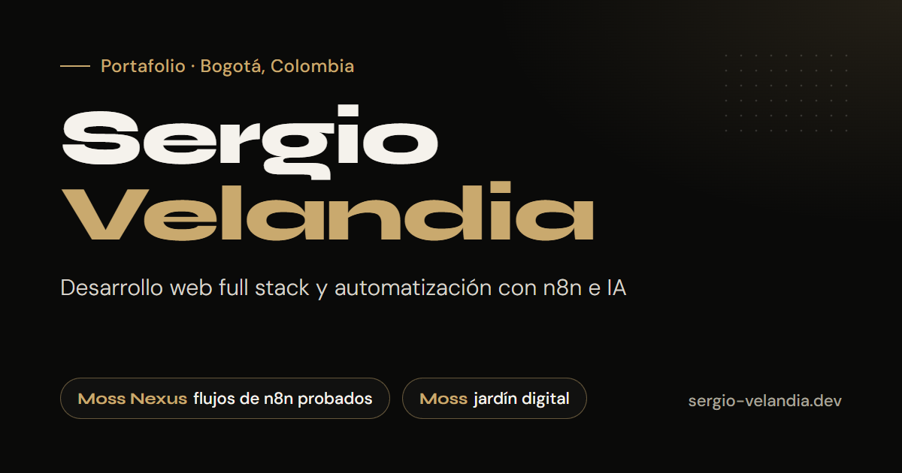

# ✦ Sergio Velandia — Portafolio Personal

Mi carta de presentación como desarrollador: quién soy, qué he construido y cómo contactarme, en español e inglés.

[🌐 Ver en vivo](https://sergio-velandia.dev/mi-portafolio/) · [🇬🇧 English version](https://sergio-velandia.dev/mi-portafolio/?lang=en) · [📄 CV](https://sergio-velandia.dev/mi-portafolio/CV_Sergio_Ramirez_Velandia.pdf) · [📬 Contacto](mailto:contacto@sergio-velandia.dev)



## 📌 Estado

| Versión | Estado | Última revisión |
|---|---|---|
| **1.2.1** | En mantenimiento | 4 de noviembre de 2026 |

Los cambios de cada versión están en el [CHANGELOG](./CHANGELOG.md) y los pendientes, en el [ROADMAP](./ROADMAP.md).

## 🚀 Proyectos que presenta

Las cifras y versiones de cada uno están en el sitio y en su propio repositorio.

- **Videojuego multijugador en Roblox:** mi experiencia profesional, en Lua y Roblox Studio.
- **[Moss Nexus](https://sergio-velandia.dev/Moss-Nexus/):** librería de flujos de n8n listos para copiar. [Repo](https://github.com/Sergio-Velandia/Moss-Nexus)
- **[Moss](https://sergio-velandia.dev/Moss/):** mi jardín digital, con rutas de aprendizaje. [Repo](https://github.com/Sergio-Velandia/Moss)
- **[Moss Taste](https://sergio-velandia.dev/Moss-Taste/):** el recetario de la familia, con cantidades y costo por porciones. [Repo](https://github.com/Sergio-Velandia/Moss-Taste)
- **Automatización de datos con n8n:** de CSV a XLSX en Google Drive. [Repo](https://github.com/Sergio-Velandia/Test-N8N)
- **Otros:** [YuGiOhApi](https://github.com/Sergio-Velandia/YuGiOhApi) y [DigimonAPI + Firebase](https://github.com/Sergio-Velandia/DigimonAPI-Firebase).

## 🛠 Desarrollo

Requisitos: Node.js y npm. La versión de Node que usa el CI está en [`deploy.yml`](./.github/workflows/deploy.yml).

```bash
git clone https://github.com/Sergio-Velandia/mi-portafolio.git
cd mi-portafolio
npm install
npm run dev        # http://localhost:5173/mi-portafolio/
```

| Comando | Qué hace |
|---|---|
| `npm test` | Pruebas con Vitest |
| `npm run lint` | Revisión del código con oxlint |
| `npm run build` | Build de producción en `dist/` |
| `npm run preview` | Sirve el build localmente |

**Stack:** React, Vite, CSS con variables y EmailJS, publicado en GitHub Pages. Las versiones están en [`package.json`](./package.json).

## 🧭 Dónde está cada cosa

Solo lo que no se deduce de los nombres:

- `src/data/`: textos y capturas de Moss Nexus, Moss y Moss Taste, en los dos idiomas.
- `src/config/sites.js`: las URLs de los proyectos, en un solo lugar.
- `src/entrada.css`: estilos de la pantalla de entrada, que crea un script en línea de `index.html`, sin React.
- `privacidad/` y `terminos/`: páginas legales en HTML estático.
- `scripts/og-card.html`: fuente de `public/og-image.png`.

## ⚠️ Reglas que no se ven en el código

**Idiomas**
- Cada componente guarda sus textos en `{ es, en }` y elige el suyo con `useLang()`.
- Las páginas legales tienen las dos versiones en la misma página (inglés en `#en`).
- Las `key` de las listas deben ser identificadores fijos, nunca el texto traducido: si la `key` cambia con el idioma, React recrea el elemento y se pierden las clases de animación.

**Despliegue**
- Cada push a `main` publica el sitio en [sergio-velandia.dev/mi-portafolio](https://sergio-velandia.dev/mi-portafolio/).
- El dominio se configura en el repositorio raíz `Sergio-Velandia.github.io`, así que este repositorio **no lleva `CNAME`**.
- Toda página nueva debe ser HTML real generado en el build, no una ruta de la SPA, para que responda 200 y los buscadores la indexen.

**Formulario de contacto**
- Usa [EmailJS](https://www.emailjs.com/). Sus constantes públicas están en `src/components/Contacto.jsx` y quedan visibles en el navegador por diseño, así que el servicio debe estar **restringido al dominio `sergio-velandia.dev`** desde su panel.
- La plantilla usa `{{from_name}}`, `{{reply_to}}` y `{{message}}`.
- Lo que el formulario hace con los datos está en la [política de privacidad](https://sergio-velandia.dev/mi-portafolio/privacidad/).

## 📄 Licencia

- **Código:** [MIT](./LICENSE).
- **Contenido:** todos los derechos reservados ([LICENSE-CONTENT](./LICENSE-CONTENT)). Textos, certificados, capturas, la imagen de vista previa y la marca personal no se pueden copiar ni publicar como propios.
- Roblox, n8n y las demás marcas mencionadas pertenecen a sus titulares; este proyecto no está afiliado a ellas.

Hecho con mucho café ☕ por **Sergio Velandia** — Colombia 🇨🇴
